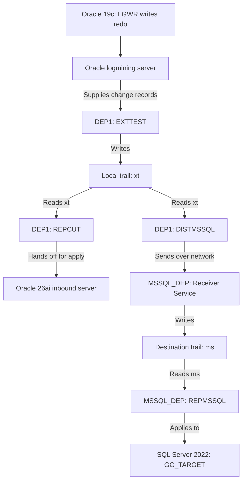

# How one committed change reaches two targets in my GoldenGate pipeline

My Data Guard–protected Oracle 19c primary is the source. Oracle 26ai and SQL Server 2022 are the GoldenGate targets. I follow one real committed change through the pipeline, then show how I verified the full test.

## 1. Oracle saves a record of the change

On November 21, 2026, I inserted ID `900010` with `NAME = 'OGG_MSSQL_INSERT_TEST'` into `HOLA.TEST1` in `PRODBHR` and committed. I then updated `NAME` to `OGG_MSSQL_UPDATE_TEST` and committed, followed by a separate DELETE and commit. Both `PDB23AI.HOLA.TEST1` and `GG_TARGET.dbo.TEST1` showed the inserted value, then the updated value, then no row for ID `900010`. I also confirmed the final DELETE on the Data Guard standby, where ID `900010` was absent.

The [November 21 validation record](../../Oracle-Database-Platform-Automation/validation/2026-11-21-one-to-many-cdc-evidence.md) records the checks at the source, both targets, and the standby.

Oracle generates **redo**, the record it uses to recover database changes. **LGWR**, the log writer, writes redo to the **online redo logs**. In ARCHIVELOG mode, Oracle can copy a completed online redo log to an **archived redo log** after a log switch. The change can already be in online redo before archiving happens.

## 2. GoldenGate captures the change

Oracle's **logmining server** interprets redo and supplies logical change records to my Integrated Extract, **EXTTEST**. A logical change record describes a change in terms of database objects and data.

EXTTEST runs in **DEP1**, my GoldenGate deployment on the hub. It connects remotely to the Oracle 19c source. It captures changes for the configured objects and writes them to **xt**, its local GoldenGate trail.

A **trail** is a series of numbered files holding captured changes. The name **xt** is the prefix shared by those files. Local means the files are on the GoldenGate deployment that writes them.

**Remember who writes what.** Oracle's LGWR writes online redo. GoldenGate's EXTTEST writes xt.

## 3. The same trail feeds two routes

| Route | Who reads xt? | What happens next? |
|---|---|---|
| Oracle 26ai | REPCUT | It reads xt in DEP1 and sends the mapped changes to Oracle 26ai's inbound server for apply. |
| SQL Server 2022 | DISTMSSQL | It ships records from xt to MSSQL_DEP, where the Receiver Service writes them to ms. REPMSSQL reads ms and applies them to GG_TARGET. |

**Same trail, separate positions.** EXTTEST writes xt. REPCUT and DISTMSSQL read it independently. One reader might be on file 5 while EXTTEST is already writing file 6.

### Follow the change through my lab

Start at the top and follow the arrows. At **xt**, the change takes two routes. REPCUT reads **xt** directly. DISTMSSQL sends records to the Receiver, which writes **ms** for REPMSSQL to read.

### Oracle route, step by step

1. **REPCUT** reads xt from its saved position.
2. Its **mapping** tells it which target table should receive the change.
3. The Oracle 26ai **inbound server** applies the change. In the November 21 test, I queried `PDB23AI.HOLA.TEST1` and observed `OGG_MSSQL_INSERT_TEST` after the INSERT, `OGG_MSSQL_UPDATE_TEST` after the UPDATE, and `no rows selected` after the DELETE for ID `900010`.
4. This route reads xt directly in DEP1, so it needs no Distribution Path or Receiver to deliver the trail.

### SQL Server route, step by step

1. **DISTMSSQL**, a Distribution Path in DEP1, reads xt and sends records across the network.
2. The **Receiver Service** in MSSQL_DEP writes the incoming records to its local **ms** trail.
3. **REPMSSQL**, the SQL Server Replicat, reads ms and uses its mapping to find the target table.
4. It applies the changes to `GG_TARGET.dbo.TEST1`. I observed `OGG_MSSQL_INSERT_TEST` after the INSERT, `OGG_MSSQL_UPDATE_TEST` after the UPDATE, and zero rows after the DELETE for ID `900010`.

## 4. Why the word Extract gets confusing

| Term | What it reads | Job |
|---|---|---|
| Integrated Primary Extract | Logical change records from Oracle's logmining server | Capture ongoing changes. EXTTEST does this. |
| Classic Primary Extract | Oracle redo directly | Capture ongoing changes in older Oracle GoldenGate environments. |
| Initial Load Extract | Existing rows in source tables | Copy the starting data. |
| Classic Data Pump Extract | An existing GoldenGate trail | Send captured changes to another location. |

**Integrated** describes how EXTTEST receives changes. **Remote** describes where it runs relative to Oracle 19c. **Microservices** describes how GoldenGate is deployed and managed.

In Classic Architecture, **Data Pump Extract sends** and **Collector receives and writes** the destination trail. In Microservices, **Distribution Service sends** through a path and **Receiver Service receives and writes**. Primary Extract and Replicat still do capture and apply.

## 5. Where changes wait when a process stops

| What stops? | Where do new changes wait? | What can still work? |
|---|---|---|
| EXTTEST | In Oracle's online and archived redo logs on the 19c source | REPCUT and DISTMSSQL can keep processing what is already in xt. EXTTEST can only catch up if the archived logs it still needs are available, so RMAN archive log deletion must not remove them first. |
| REPCUT | In xt | EXTTEST can keep writing. The SQL Server branch can keep going if its components are healthy. |
| DISTMSSQL | In xt before shipment | REPCUT can keep applying to Oracle. REPMSSQL can still apply changes already in ms. |
| REPMSSQL | In ms | The Receiver can keep writing while SQL Server apply is stopped. |

A **checkpoint** is a saved progress marker. A reader can resume using its checkpoint if the required trail files are still available.

## 6. Find the last place the change reached

1. **Capture:** During known committed changes to a captured table, compare EXTTEST's redo checkpoint and xt write position over time. Oracle uses an **SCN**, or System Change Number, to identify positions in the database's change history.
2. **Transport:** If xt advances and ms stays still, check DISTMSSQL and the Receiver Service.
3. **Apply:** If ms advances but REPMSSQL's checkpoint stays still across samples, check REPMSSQL status and its report. If it is running with no clear error, check whether SQL Server is blocking the apply session.
4. **Proof:** Query the expected row on the target after a known source change. A running process or growing trail shows progress at that stage. The expected target row confirms the specific change arrived and was applied.

A trail **sequence** identifies the numbered file. The **RBA** is the byte offset inside that file. Compare sequence first because the offset can reset when a new file starts. **Lag** is a measure of delay at a stage. Check it alongside checkpoint movement and actual workload.

## Quick review

- Who writes Oracle online redo? **LGWR.**
- Who writes xt? **EXTTEST.**
- Why can REPCUT share xt with EXTTEST? **It reads the same files in DEP1 and keeps its own checkpoint.**
- Who writes ms? **The Receiver Service in MSSQL_DEP.**
- What verified SQL Server apply for ID `900010`? **Queries on `GG_TARGET.dbo.TEST1` showed the inserted value, the updated value, and zero rows after the DELETE.**

For setup and validation steps, see the [implementation runbook](../runbooks/oracle19c-dataguard-to-oracle26ai-and-sqlserver2022.md).
