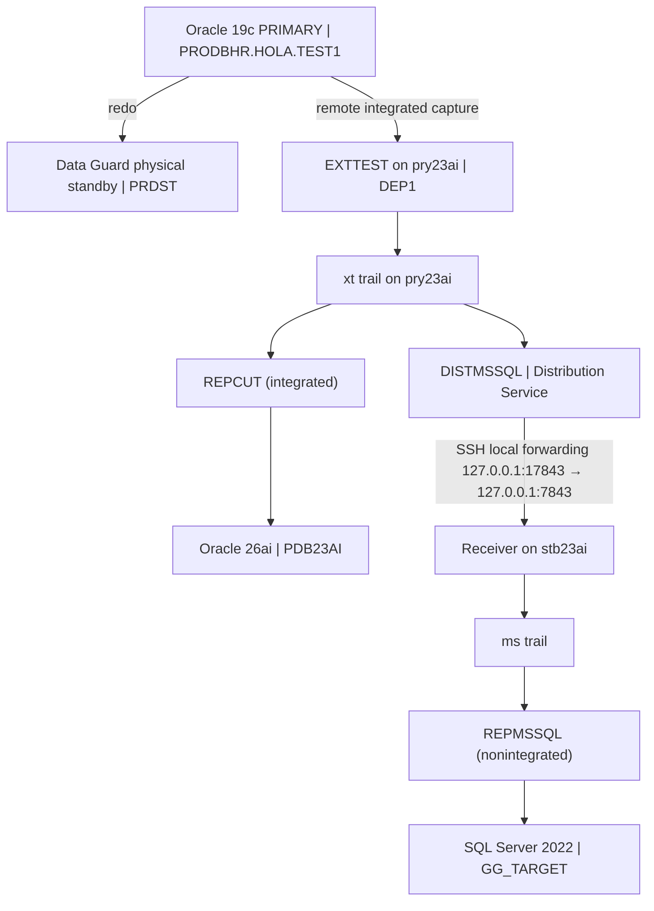

# Oracle 19c (Data Guard) → Oracle 26ai and SQL Server 2022: One-to-Many Heterogeneous Replication with GoldenGate 26ai

Revision 3.0 — 2026-11-21 | Local-lab implementation, recovery and test evidence

## 1. Summary

I built a one-to-many GoldenGate replication path from an Oracle 19c **primary** database, CDB `PRODB`, PDB `PRODBHR`, to an Oracle 26ai PDB and a SQL Server 2022 database. GoldenGate's integrated Extract `EXTTEST` runs remotely in `DEP1`, writes `xt`, and feeds the Oracle integrated Replicat `REPCUT` plus the SQL Server path `DISTMSSQL` → `ms` → nonintegrated `REPMSSQL`. Independently, Oracle Data Guard transports and applies redo to physical standby `PRDST`; **GoldenGate captures from the primary, never from that standby**. On November 21 I committed INSERT, UPDATE and DELETE on `PRODBHR.HOLA.TEST1` and verified the same DML at both GoldenGate targets. The final DELETE was also confirmed on the Data Guard standby, and Broker reported SUCCESS. My earlier OCI-to-Azure SQL Server migration is a different project; those free-tier cloud subscriptions expired and this runbook documents only the current on-premises lab.

## 2. Architecture

Oracle renamed its database product **23ai to 26ai**; the surviving hostnames `pry23ai` and `stb23ai` are legacy names and do not imply an older installed database release. `stb23ai` is a Linux GoldenGate host; `stb` / `PRDST` is the separate Oracle 19c standby.

| Node | Role and data | Address / ports |
|---|---|---|
| `pry` | Oracle 19c PRIMARY `PRODB/PRODBHR`; `HOLA.TEST1` source | `192.168.4.111` |
| `stb` / `PRDST` | Data Guard PHYSICAL STANDBY; READ ONLY WITH APPLY | `192.168.4.112` |
| `pry23ai` | Oracle 26ai `PDB23AI`; GoldenGate `DEP1`, integrated `EXTTEST` + `REPCUT` | `192.168.4.113`; Service Manager 7820, Admin UI 7821, Distribution 7822 |
| `stb23ai` | GoldenGate SQL Server `MSSQL_DEP`; Receiver and `REPMSSQL`; no SQL Server engine | `192.168.4.114`; Service Manager 7840, Admin UI 7841, Distribution 7842, Receiver 7843, Performance Metrics Service 7844 |
| Windows desktop | SQL Server 2022 Developer; `GG_TARGET.dbo.TEST1` | `192.168.4.20:1433` |



**Port distinction:** `CONNECT http://127.0.0.1:7820 DEPLOYMENT DEP1` and `CONNECT http://127.0.0.1:7840 DEPLOYMENT MSSQL_DEP` are valid **Admin Client connections through Service Manager**. GoldenGate web Administration UIs use **7821** and **7841**. Different service ports are intentional.

## 3. Verified results — November 21, 2026

| Test | Oracle 19c primary | Oracle 26ai `PDB23AI` | SQL Server `GG_TARGET` | Data Guard standby |
|---|---|---|---|---|
| INSERT `900010` | `OGG_MSSQL_INSERT_TEST` committed | Row observed | Row observed | Not independently checked at INSERT |
| UPDATE `900010` | `OGG_MSSQL_UPDATE_TEST` committed | Updated value observed | Updated value observed | Not checked |
| DELETE `900010` | `1 row deleted`, COMMIT | `no rows selected` | 0 rows | `no rows selected` |

Earlier, after recovery of the stalled `EXTTEST`, a fresh INSERT had reached **the receiving `ms` trail only**: `REPMSSQL` was not started, and that earlier event was **not demonstrated as applied to SQL Server**. SQL Server's four baseline `TEST1` rows were seeded separately. The later row `900010` checks above are the successful end-to-end test.

Data Guard Broker `my_dg`: `MaxAvailability`, members `prodb` primary and `prdst` physical standby, configuration `SUCCESS`, Fast-Start Failover **Disabled**. This is a successfully observed lab validation, not a switchover, automatic failover or measured zero-loss proof.

**Evidence:** The November 21 source, target and Data Guard checks are documented in the [validation evidence index](../../Oracle-Database-Platform-Automation/validation/2026-11-21-one-to-many-cdc-evidence.md). Original screenshots are retained privately and will be published only after redaction. The repository currently contains the text evidence index, not the screenshot files.

## 4. Implementation procedure (existing installed software)

Run Bash **on the Linux hosts through MobaXterm SSH on Windows**; PowerShell on Windows; Oracle SQL in SQL*Plus; T-SQL in SSMS; GoldenGate commands at its Admin Client prompt. The commands below reproduce the observed deployed configuration, but the original bare-metal installers were not captured.

### 4.1 GoldenGate service lifecycle — stb23ai

If both services already work, skip creation and run the validation gate below.

**Bash, stb23ai, oracle:**
```bash
systemctl cat OracleGoldenGate.service
ls -ld /u02/ogg_mssql_home /u02/ogg_mssql_sm/{etc,var} /u02/ogg_mssql_deploy
ls -l /u02/ogg_mssql_home/bin/ServiceManager
ps -eo pid,ppid,user,stat,args | grep '[o]gg_mssql_home/bin/'
ss -lntp | grep -E ':783[0-4]\b|:784[0-4]\b'
```
If an existing MSSQL unit or manually running processes are present, use an approved shutdown window and verify Extract/Replicat and distribution paths are idle before changing lifecycle management.
```bash
sudo tee /usr/bin/OracleGoldenGateMSSQL.sh >/dev/null <<'WRAPPER'
#!/bin/bash
set -e
export OGG_HOME=/u02/ogg_mssql_home
export OGG_ETC_HOME=/u02/ogg_mssql_sm/etc
export OGG_VAR_HOME=/u02/ogg_mssql_sm/var
unset ORACLE_HOME ORACLE_SID ORACLE_BASE TNS_ADMIN LD_LIBRARY_PATH
exec "${OGG_HOME}/bin/ServiceManager"
WRAPPER
sudo chown root:root /usr/bin/OracleGoldenGateMSSQL.sh
sudo chmod 755 /usr/bin/OracleGoldenGateMSSQL.sh
sudo restorecon -v /usr/bin/OracleGoldenGateMSSQL.sh
bash -n /usr/bin/OracleGoldenGateMSSQL.sh
```
Create `/etc/systemd/system/OracleGoldenGateMSSQL.service` with `sudo vi` (press i, paste, Esc, :wq) or heredoc:
```ini
[Unit]
Description=Oracle GoldenGate 26ai Service Manager for SQL Server
Wants=network-online.target
After=network-online.target
RequiresMountsFor=/u02/ogg_mssql_home /u02/ogg_mssql_sm /u02/ogg_mssql_deploy
StartLimitIntervalSec=300
StartLimitBurst=3
[Service]
Type=simple
User=oracle
Group=oracle
WorkingDirectory=/home/oracle
Environment="HOME=/home/oracle"
ExecStart=/usr/bin/OracleGoldenGateMSSQL.sh
Restart=on-failure
RestartSec=30
TimeoutStopSec=90
KillMode=control-group
[Install]
WantedBy=multi-user.target
```
```bash
sudo systemd-analyze verify /etc/systemd/system/OracleGoldenGateMSSQL.service
sudo systemctl daemon-reload
sudo systemctl start OracleGoldenGateMSSQL.service
systemctl status OracleGoldenGateMSSQL.service --no-pager -l
systemctl show OracleGoldenGateMSSQL.service -p MainPID -p NRestarts -p ControlGroup
```
Gate: active/running, nonzero PID, no duplicate old processes, all five MSSQL listeners.
```bash
sudo systemctl enable OracleGoldenGateMSSQL.service
systemctl is-active OracleGoldenGate.service OracleGoldenGateMSSQL.service
systemctl is-enabled OracleGoldenGate.service OracleGoldenGateMSSQL.service
for port in {7840..7844}; do curl --noproxy '*' -sS --max-time 5 -o /dev/null -w "Port $port: HTTP %{http_code}\n" "http://127.0.0.1:$port/"; done
```
VERIFIED: both active/enabled, all five MSSQL HTTP 200; SELinux enforcing.

### 4.2 SQL Server database and login — Windows / SSMS

Windows PowerShell:
```powershell
Get-Service | Where-Object { $_.Name -match 'MSSQL|SQLAgent|SQLBrowser' }
Get-NetTCPConnection -LocalPort 1433 -State Listen -ErrorAction SilentlyContinue
ipconfig
```
SSMS, New Query, connect using authorized admin account:
```sql
SELECT @@SERVERNAME, SERVERPROPERTY('ProductVersion'), SERVERPROPERTY('Edition'), SERVERPROPERTY('IsIntegratedSecurityOnly');
SELECT name,state_desc,recovery_model_desc FROM sys.databases;
SELECT name,is_disabled,default_database_name FROM sys.server_principals WHERE name='ggadmin';
SELECT IS_SRVROLEMEMBER('sysadmin','ggadmin') AS IsSysAdmin;
```
Expected 16.x Developer, Mixed Mode (0), database GG_TARGET ONLINE, ggadmin enabled, not sysadmin.
```bash
timeout 5 bash -c 'true > /dev/tcp/192.168.4.20/1433' && echo PASS || echo FAIL
```
SSMS:
```sql
USE GG_TARGET;
SELECT name,type_desc,default_schema_name FROM sys.database_principals WHERE name='ggadmin';
SELECT r.name AS role_name,m.name AS member_name FROM sys.database_role_members d JOIN sys.database_principals r ON r.principal_id=d.role_principal_id JOIN sys.database_principals m ON m.principal_id=d.member_principal_id WHERE m.name='ggadmin';
```
VERIFIED: TCP pass, db_owner, no sysadmin, FULL recovery.

### 4.3 ODBC, credential and checkpoint table — stb23ai

On stb23ai, Bash:
```bash
rpm -q unixODBC unixODBC-devel
odbcinst -j
odbcinst -q -d
ls -l /u02/ogg_mssql_home/msodbc/lib64/
ldd /u02/ogg_mssql_home/msodbc/lib64/libmsodbcsql.so
```
Verify no missing dependencies. Do not replace system ODBC libraries to suppress the historical version warning. Back up existing ODBC files; if absent, create these GoldenGate-specific entries (review other DSNs before editing):

`/u02/ogg_mssql_home/msodbc/odbcinst.ini`:
```ini
[Microsoft ODBC Driver for SQL Server]
Description=Microsoft ODBC Driver for SQL Server
Driver=/u02/ogg_mssql_home/msodbc/lib64/libmsodbcsql.so
```
`/u02/ogg_mssql_home/msodbc/odbc.ini`:
```ini
[GG_TARGET_DSN]
Driver=Microsoft ODBC Driver for SQL Server
Server=tcp:192.168.4.20,1433
Database=GG_TARGET
Encrypt=yes
TrustServerCertificate=yes
```
Verify actual deployed Admin Server environment:
```bash
pid=$(pgrep -f '^/u02/ogg_mssql_home/bin/adminsrvr ' | head -1)
tr '\0' '\n' < /proc/$pid/environ | grep '^ODBC'
```
Expected ODBCSYSINI=/u02/ogg_mssql_home/msodbc and ODBCINI=/u02/ogg_mssql_home/msodbc/odbc.ini.

On Windows PowerShell, check local ports before starting browser tunnel. If used, inspect the owning process rather than terminating blindly.
```powershell
Get-NetTCPConnection -LocalPort 7840,7841,7842,7843,7844 -State Listen -ErrorAction SilentlyContinue
ssh -N -o ExitOnForwardFailure=yes -o ServerAliveInterval=30 -o ServerAliveCountMax=3 -L 127.0.0.1:7840:127.0.0.1:7840 -L 127.0.0.1:7841:127.0.0.1:7841 -L 127.0.0.1:7842:127.0.0.1:7842 -L 127.0.0.1:7843:127.0.0.1:7843 -L 127.0.0.1:7844:127.0.0.1:7844 oracle@192.168.4.114
```
Keep this terminal open; blank screen is normal.

On stb23ai Bash, launch `/u02/ogg_mssql_home/bin/adminclient`, then at Admin Client prompt:
```text
CONNECT http://127.0.0.1:7840 DEPLOYMENT MSSQL_DEP AS oggadmin
INFO CREDENTIALSTORE
DBLOGIN USERIDALIAS GG_TARGET_ALIAS
INFO CHECKPOINTTABLE dbo.GG_CHECKPOINT
```
If DBLOGIN succeeds and checkpoint table absent, run `ADD CHECKPOINTTABLE dbo.GG_CHECKPOINT` and repeat INFO.
```sql
USE GG_TARGET;
SELECT SCHEMA_NAME(schema_id),name,create_date FROM sys.tables WHERE name LIKE 'GG_CHECKPOINT%';
SELECT * FROM dbo.GG_CHECKPOINT;
```
VERIFIED: DBLOGIN succeeded; main checkpoint and _lox companion created, main empty.

### 4.4 Receiver connectivity and restricted SSH tunnel

On pry23ai Bash:
```bash
ip route get 192.168.4.114
ping -c 3 192.168.4.114
timeout 5 bash -c 'true > /dev/tcp/192.168.4.114/22'
timeout 5 bash -c 'true > /dev/tcp/192.168.4.114/7843'
```
On stb23ai Bash:
```bash
hostname
ip -br addr
ss -lntp | grep ':7843'
sudo firewall-cmd --state
sudo firewall-cmd --get-active-zones
sudo firewall-cmd --zone=public --list-rich-rules
```
Observed SSH reachable, Receiver bound to 127.0.0.1:7843.

On pry23ai as oracle, generate a dedicated key only if absent:
```bash
ssh-keygen -t ed25519 -f ~/.ssh/gg_mssql_ed25519 -C 'GoldenGate-MSSQL-Tunnel'
printf 'from="192.168.4.113",restrict,port-forwarding,permitopen="127.0.0.1:7843",command="/bin/false" %s\n' "$(cat ~/.ssh/gg_mssql_ed25519.pub)" > ~/.ssh/gg_mssql_restricted.pub
ssh-copy-id -f -i ~/.ssh/gg_mssql_restricted.pub oracle@192.168.4.114
```
For unattended startup, the tested key worked without prompts. Protect private key (0600), verify target host fingerprint out of band, never disable StrictHostKeyChecking. Check target authorized_keys before repeating forced installation to avoid duplicates.
On stb23ai (not pry23ai):
```bash
grep 'GoldenGate-MSSQL-Tunnel' ~/.ssh/authorized_keys
ls -ld ~/.ssh
ls -l ~/.ssh/authorized_keys
```
Expected 0700 directory, 0600 file, oracle ownership.

Manual test on pry23ai:
```bash
ssh -fNT -i /home/oracle/.ssh/gg_mssql_ed25519 \
 -o IdentitiesOnly=yes -o BatchMode=yes -o StrictHostKeyChecking=yes \
 -o ExitOnForwardFailure=yes -o ServerAliveInterval=30 -o ServerAliveCountMax=3 \
 -o ConnectTimeout=10 -L 127.0.0.1:17843:127.0.0.1:7843 oracle@192.168.4.114
ss -lntp | grep ':17843'
curl --noproxy '*' -sS --max-time 10 -o /dev/null -w 'Receiver HTTP: %{http_code}\n' http://127.0.0.1:17843/
```
Observed HTTP 200.

**Production hardening:** The `authorized_keys` key options `restrict,port-forwarding,permitopen=` bound a tested tunnel to the required destination but `port-forwarding` alone can still permit remote (`-R`) forwarding. Prefer a dedicated tunnel account with an `sshd_config` `Match User` block using `AllowTcpForwarding local`, plus `PermitOpen 127.0.0.1:7843`, with administrator-approved change and negative tests before deployment.

### 4.5 Persistent SSH tunnel — pry23ai

On pry23ai, create wrapper with shebang at byte zero:
```bash
sudo tee /usr/bin/GoldenGateMSSQLTunnel.sh >/dev/null <<'WRAPPER'
#!/bin/bash
exec /usr/bin/ssh -NT \
 -i /home/oracle/.ssh/gg_mssql_ed25519 \
 -o IdentitiesOnly=yes -o BatchMode=yes -o StrictHostKeyChecking=yes \
 -o UserKnownHostsFile=/home/oracle/.ssh/known_hosts \
 -o ExitOnForwardFailure=yes -o ServerAliveInterval=30 -o ServerAliveCountMax=3 \
 -o ConnectTimeout=10 -L 127.0.0.1:17843:127.0.0.1:7843 oracle@192.168.4.114
WRAPPER
sudo chown root:root /usr/bin/GoldenGateMSSQLTunnel.sh
sudo chmod 755 /usr/bin/GoldenGateMSSQLTunnel.sh
sudo restorecon -v /usr/bin/GoldenGateMSSQLTunnel.sh
head -n 1 /usr/bin/GoldenGateMSSQLTunnel.sh | cat -A
file /usr/bin/GoldenGateMSSQLTunnel.sh
bash -n /usr/bin/GoldenGateMSSQLTunnel.sh
```
Unit `/etc/systemd/system/GoldenGateMSSQLTunnel.service`:
```ini
[Unit]
Description=GoldenGate SSH Tunnel to MSSQL Receiver Service
Wants=network-online.target
After=network-online.target
StartLimitIntervalSec=0
[Service]
Type=simple
User=oracle
Group=oracle
WorkingDirectory=/home/oracle
Environment="HOME=/home/oracle"
ExecStart=/usr/bin/GoldenGateMSSQLTunnel.sh
Restart=always
RestartSec=10
TimeoutStopSec=30
KillMode=control-group
[Install]
WantedBy=multi-user.target
```
Back up existing unit before changing. Verify manual listener PID via ss and `ps -ww -p PID -o pid,ppid,user,args`; terminate only matching manual SSH process with kill -TERM PID, confirm port vacant. Never use pkill ssh/killall ssh.
```bash
sudo systemd-analyze verify /etc/systemd/system/GoldenGateMSSQLTunnel.service
sudo systemctl daemon-reload
sudo systemctl start GoldenGateMSSQLTunnel.service
sudo systemctl status GoldenGateMSSQLTunnel.service --no-pager -l
systemctl show GoldenGateMSSQLTunnel.service -p MainPID -p NRestarts -p Result -p ActiveState -p SubState
ss -lntp | grep ':17843'
PID=$(systemctl show -p MainPID --value GoldenGateMSSQLTunnel.service)
ps -p "$PID" -o pid,ppid,user,label,args -ww
getenforce
sudo systemctl enable GoldenGateMSSQLTunnel.service
systemctl is-enabled GoldenGateMSSQLTunnel.service
```
Repeat the Receiver HTTP probe from section 4.4. Controlled process recovery test (only before CDC or in approved outage window):
```bash
sudo systemctl kill --kill-who=main --signal=SIGTERM GoldenGateMSSQLTunnel.service
sleep 15
systemctl show GoldenGateMSSQLTunnel.service -p MainPID -p NRestarts -p ActiveState -p SubState
sudo journalctl -u GoldenGateMSSQLTunnel.service -n 20 --no-pager
```
Repeat HTTP probe. Evidence: PID 175247 terminated 07:23:53, restart scheduled/executed 07:24:03, counter 1, new listener PID 176948, HTTP 200. Boot startup enabled but actual reboot not tested. Network disruption/reconnect and Receiver outage recovery not tested. HTTP root 200 proves reachability, not CDC health.

Rollback: stop/disable only GoldenGateMSSQLTunnel.service, restore backed-up configuration; if approved, restore the previously tested manual tunnel on free port.

### 4.6 Distribution credentials and path configuration

1. Windows Chrome: open http://127.0.0.1:7841/services/v2/content/ (MSSQL_DEP). User Administration > Users +. Username ggnet, Operator role, Password authentication, strong unique password and verification, Info: Dedicated GoldenGate Operator account for Oracle 19c to SQL Server 2022 trail distribution from DEP1 to MSSQL_DEP. Submit only if absent. Verify user listed. Actual final role was not independently captured; verify before reuse.
2. Open http://192.168.4.113:7821/services/v2/content/ (DEP1). Port 7820 is Service Manager for Admin Client CONNECT; the Administration web UI runs at 7821. Click Path Connections (not Distribution Service Paths), then +. Domain Network; alias MSSQL_NET; User ID ggnet; password and verification must match target application user; No Password Required OFF. Submit and verify alias listed.
3. Do not use SQL Server ggadmin or GG_TARGET_ALIAS for transport. No restart required. Rollback: remove only newly created unused alias/user after checking dependencies; do not alter administrator account.

Preflight on pry23ai: verify EXTTEST running, view parameters, confirm trail xt, verify tunnel HTTP 200. Check Distribution Service Paths for existing DISTMSSQL. If it exists, inspect instead of creating. Verify target ms prefix is not used by another path. For a fresh exercise, establish a transaction-consistent empty baseline, pause writes to the selected source table, verify retained source trail boundary and choose an intentional starting position; do not guess a historical RBA. The historical starting position was not captured. Keep writes paused until Replicat is ready. If a safe boundary cannot be established, stop. Do not reset an existing reader.

Open DEP1 Administration > Distribution Service Paths > Add Path (+). Click Next after each page.

### Page 1 — Path Information
| Field | Value |
|---|---|
| Path Name | DISTMSSQL |
| Description | Oracle 19c to SQL Server 2022 CDC via persistent SSH tunnel |
| Air Gap Security | OFF |

### Page 2 — Source Options
| Field | Value |
|---|---|
| Extract | EXTTEST |
| Source trail | xt |
| Starting position | Approved source sequence/RBA or intentional current boundary; historical value unknown |

Capture a screenshot or sanitized export of the chosen position before proceeding.

### Page 3 — Target Options
| Field | Value |
|---|---|
| Target Protocol | ws |
| Reverse proxy | OFF |
| Host | 127.0.0.1 (local to pry23ai, not Windows) |
| Port | 17843 |
| Trail Name | ms |
| Subdirectory | Blank |
| Trail Size MB | 500 |
| Encryption Algorithm | NONE |
| Change Encryption | OFF |
| Target Authentication Method | UserID Alias |
| Domain | Network |
| Alias | MSSQL_NET |
| Target Type | GGFormat |

Generated URI: `ws://127.0.0.1:17843/services/v2/targets?trail=ms`. SSH encrypts inter-host transit; native TLS and trail-at-rest encryption not configured. Verified path worked in this lab; do not represent this as a certified production authentication configuration.

### Page 4 — Advanced Options
Keep defaults: TCP Flush Bytes/Seconds blank; DSCP DEFAULT; TOS DEFAULT; TCP_NODELAY ON; Quick ACK OFF; TCP_CORK OFF; send/receive buffers and Keep Alive blank.

### Page 5 — Filtering Options
Proposed rule MSSQL_CDC_FILTER, Include, Object Names, PRODBHR.HOLA.TEST1_CDC_LAB, Negate unchecked. **Not verified as effective or saved.** Actual remote trail included five unrelated tables. For a repeat exercise explicitly approve whether full trail transport is acceptable; if not, stop and validate filter syntax and positive/negative tests before starting. Explicit MAP later limits apply, not transport. Do not assume an Include rule excludes all unmatched records. Capture effective configuration and record the decision.

### Page 6 — Managed Options
Critical OFF; Auto Restart ON; Autorestart Retries 10; Autorestart Delay 2 minutes. Review all pages, then Create and Run only if the preflight conditions pass. Verify Running and reported lag; zero lag alone is insufficient. Historical result: Running, zero seconds, Nov 20. Rollback: stop only the new path; retain trails and checkpoints for investigation; do not delete or reposition shared xt.

### Browser timeout recovery
If the wizard times out, log in again.
```bash
curl --noproxy '*' -sS --max-time 10 -o /dev/null -w 'Receiver HTTP: %{http_code}\n' http://127.0.0.1:17843/
```
If HTTP 200, keep tunnel.

**Boot order:** No existing dependency guarantees `DISTMSSQL` starts only after `GoldenGateMSSQLTunnel.service` is available. Managed options are 10 auto-restart retries with a 2-minute delay, leaving an approximate **20-minute retry window**; the path may stay stopped after a prolonged tunnel outage. For a future rebuild, establish systemd ordering or an explicit boot-time receiver check and a path restart/verification procedure. Do not assume `Wants=network-online.target` alone solves the cross-host ordering.

### 4.7 Verify receiver trail

On stb23ai:
```bash
ls -lh /u02/ogg_mssql_deploy/var/lib/data/
find /u02/ogg_mssql_deploy -type f -name 'ms[0-9]*' -ls
/u02/ogg_mssql_home/bin/logdump
```
Logdump commands:
```text
OPEN /u02/ogg_mssql_deploy/var/lib/data/ms000000000
GHDR ON
DETAIL ON
DETAIL DATA
COUNT
EXIT
```
CONNECT is an Admin Client command, not Logdump; incorrect attempt yielded shell command not found. Logdump does not require database authentication. Avoid sharing detail data containing actual row values.
**Historical Nov 20 observation:** file sequence 0, 13,148 bytes, oracle:oracle mode 640. COUNT: 29 records, 9,124 data bytes, reported average of 20 transactions; 5 INSERT, 5 UPDATE, 5 DELETE, 4 DDL, 6 metadata, 2 RestartOK, 1 RestartAbend, 1 other. One DML of each type for PRODBHR.FOX.ILOAD and PRODBHR.HOLA.{CHILDREN_NAMES,FOX,GG_DDL_PROBE,TEST1}. No TEST1_CDC_LAB records in inspected file. Historical RestartAbend not current failure. Zero lag not end-to-end consistency evidence.

### 4.8 SQL Server target table from source metadata

On **pry / Oracle 19c PRODBHR**, SQL*Plus:

```sql
SELECT DBMS_METADATA.GET_DDL('TABLE','TEST1','HOLA') FROM DUAL;
```

Observed relevant columns: `ID NUMBER` primary key, `NAME VARCHAR2(50)`.

On **Windows SSMS**, only for a fresh empty target in an authorized lab:

```sql
USE GG_TARGET;
GO
IF OBJECT_ID(N'dbo.TEST1',N'U') IS NULL
BEGIN
  CREATE TABLE dbo.TEST1 (
      ID DECIMAL(38,0) NOT NULL,
      NAME VARCHAR(50) NULL,
      CONSTRAINT PK_TEST1 PRIMARY KEY (ID)
  );
END;
GO
SELECT ID,NAME FROM dbo.TEST1 ORDER BY ID;
GO
```

**Observed:** The CREATE TABLE completed and I seeded the four matching baseline rows. The exact seed method was not independently captured. On another lab, use a controlled, transaction-consistent data initialization and validate all rows before setting the Replicat start position. Do not describe this as a universally safe bulk-load procedure.

**Datatype review:** Oracle `NUMBER` without scale/precision constraints is not universally equivalent to SQL Server `DECIMAL(38,0)`; review fractional values, precision and constraints. `VARCHAR2` → `VARCHAR` requires explicit review of byte-versus-character semantics, character encoding and collation.

### 4.9 REPMSSQL group, parameter file and checkpoint

**On stb23ai, Bash:**

```bash
/u02/ogg_mssql_home/bin/adminclient
```

**In GoldenGate Admin Client:**

```text
CONNECT http://127.0.0.1:7840 DEPLOYMENT MSSQL_DEP AS oggadmin
DBLOGIN USERIDALIAS GG_TARGET_ALIAS
INFO CHECKPOINTTABLE dbo.GG_CHECKPOINT
INFO ALL
```

Only if the checkpoint table does not exist, create it under a properly authorized account using the supported `ADD CHECKPOINTTABLE dbo.GG_CHECKPOINT` command, then verify it. Never edit checkpoint rows manually. Only if `REPMSSQL` does not exist:

```text
ADD REPLICAT REPMSSQL, EXTTRAIL ms, CHECKPOINTTABLE dbo.GG_CHECKPOINT, BEGIN NOW
INFO REPLICAT REPMSSQL, DETAIL
```

**What I actually saw:** ADD succeeded (`OGG-08100`) and also logged `OGG-06594` about duplicate suppression. `INFO REPLICAT` showed STOPPED, NONINTEGRATED, checkpoint table `dbo.GG_CHECKPOINT`, and an initialized `ms000000000` checkpoint. A second ADD returned `OGG-12030` because the group already existed. Typing `CHECKPOINTTABLE ...` as a stand-alone command returned Invalid command. Neither error required deletion or re-creation.

**On stb23ai, Bash, create parameters only if absent:**

```bash
if test -e /u02/ogg_mssql_deploy/etc/conf/ogg/repmssql.prm; then
  echo "Existing parameter file: review it; do not overwrite."
else
cat > /u02/ogg_mssql_deploy/etc/conf/ogg/repmssql.prm <<'EOF'
REPLICAT REPMSSQL
USERIDALIAS GG_TARGET_ALIAS

MAP PRODBHR.HOLA.TEST1, TARGET dbo.TEST1;
EOF
fi
cat /u02/ogg_mssql_deploy/etc/conf/ogg/repmssql.prm
```

The guard above preserves any existing parameter file. **Observed parameters** match the four lines above.

`BEGIN NOW` did not prove the desired initial boundary in this session. My SQL Server target already had four historical rows, so I inspected the remote trail *after* matching the baseline, then positioned REPMSSQL while stopped. **This is not evidence of an SCN-based, gap-free production initial load.**

**On stb23ai, Logdump:**

```text
OPEN /u02/ogg_mssql_deploy/var/lib/data/ms000000001
POS EOF
```

**Observed at that time:** `Reading forward from RBA 10,080`. With `REPMSSQL` STOPPED, I then used Admin Client:

```text
ALTER REPLICAT REPMSSQL, EXTSEQNO 1, EXTRBA 10080
INFO REPLICAT REPMSSQL, DETAIL
```

**Observed:** `OGG-08100 Replicat altered`; checkpoint now showed `ms000000001`, RBA `10080`. This command bypasses all earlier trail history. Use it **only** when those transactions are already reflected in the target, the correct commit boundary is established, and source writes are controlled. It is unsafe to reuse `1/10080` in another environment. For a production initialization, follow a supported SCN/transaction-consistent instantiation and cutover procedure, retain the trails and reconcile exact business rows and transaction gaps.

### 4.10 Start REPMSSQL

**On stb23ai, GoldenGate Admin Client:**

```text
START REPLICAT REPMSSQL
INFO ALL
INFO REPLICAT REPMSSQL, DETAIL
```

**Observed:** `OGG-00975` starting and `OGG-15445` started, then `REPMSSQL RUNNING NONINTEGRATED` with checkpoint lag 0. The report said it connected to `GG_TARGET`, SQL Server 2022, DSN `GG_TARGET_DSN`, using Microsoft ODBC Driver 18.4, and opened `ms000000001` at RBA `10080`.

If ABENDED or the checkpoint stalls, stop and check on stb23ai:

```bash
tail -80 /u02/ogg_mssql_deploy/var/lib/report/REPMSSQL.rpt
tail -80 /u02/ogg_mssql_deploy/var/log/ggserr.log
```

Do **not** blindly restart, reset checkpoints or enable `HANDLECOLLISIONS`. Check the error and whether data already applied.

### 4.11 Transaction-by-transaction test

Use only a **fresh lab test ID** and perform each change at the Oracle primary. In the original test the ID was `900010`; confirm it is absent before reusing it.

**A. INSERT on pry / Oracle 19c PRIMARY in PRODBHR:**

```sql
SHOW CON_NAME;
SELECT ID,NAME FROM HOLA.TEST1 WHERE ID=900010;
INSERT INTO HOLA.TEST1 (ID,NAME)
VALUES (900010,'OGG_MSSQL_INSERT_TEST');
COMMIT;
SELECT ID,NAME FROM HOLA.TEST1 WHERE ID=900010;
```

**Confirm** that INSERT affected one row and was committed. On **pry23ai** in `PDB23AI`, run `SELECT ID,NAME FROM HOLA.TEST1 WHERE ID=900010;`. On **Windows SSMS**, run:

```sql
USE GG_TARGET;
GO
SELECT ID,NAME FROM dbo.TEST1 WHERE ID=900010;
GO
```

**Observed:** both target databases returned `900010 / OGG_MSSQL_INSERT_TEST`.

**B. UPDATE only on pry / Oracle 19c PRIMARY:**

```sql
UPDATE HOLA.TEST1 SET NAME='OGG_MSSQL_UPDATE_TEST' WHERE ID=900010;
COMMIT;
SELECT ID,NAME FROM HOLA.TEST1 WHERE ID=900010;
```

Repeat the two target SELECTs above.

**Observed:** Oracle 26ai and SQL Server both returned `900010 / OGG_MSSQL_UPDATE_TEST`.

**C. DELETE only on pry / Oracle 19c PRIMARY:**

```sql
DELETE FROM HOLA.TEST1 WHERE ID=900010;
COMMIT;
SELECT ID,NAME FROM HOLA.TEST1 WHERE ID=900010;
```

Repeat the two target SELECTs. **Observed:** one source row deleted, commit completed, and both Oracle 26ai and SQL Server queries returned no rows.

**D. Verify Data Guard standby as a separate path, on standby host 192.168.4.112:**

```sql
SHOW CON_NAME;
ALTER SESSION SET CONTAINER=PRODBHR;
SELECT name,database_role,db_unique_name,open_mode FROM v$database;
SELECT ID,NAME FROM HOLA.TEST1 WHERE ID=900010;
```

**Observed:** `DB_UNIQUE_NAME=PRDST`, `PHYSICAL STANDBY`, `READ ONLY WITH APPLY`, and no row `900010` after the source DELETE. Data Guard Broker `SHOW CONFIGURATION` displayed configuration `my_dg`, `MaxAvailability`, members `prodb` primary and `prdst` physical standby, overall `SUCCESS`, and **Fast-Start Failover disabled**. This verifies the test row's final state, not measured apply lag or switchover readiness.

**Record evidence after each transaction:**

On pry23ai (DEP1):
```text
INFO ALL
INFO EXTRACT EXTTEST, DETAIL
INFO DISTPATH DISTMSSQL
STATS REPLICAT REPCUT, TOTAL
```

On stb23ai (MSSQL_DEP):
```text
INFO ALL
STATS REPLICAT REPMSSQL, TOTAL
INFO REPLICAT REPMSSQL, DETAIL
```

Record source commit time, target observation time, checkpoint advancement, errors, and exact rows. Avoid calling 0 seconds checkpoint lag proof of 0 RPO or complete replication. My observed source and target results confirm these DML changes reached both GoldenGate targets; they are not a formal latency benchmark.

**Supplemental logging status:** On November 21 `DBLOGIN USERIDALIAS SRC19CROOT` succeeded against `PRODB/CDB$ROOT`, but `INFO TRANDATA PRODBHR.HOLA.TEST1` returned `OGG-00664` and Oracle `ORA-01031: insufficient privileges`. That is an authorization failure for the inspection, not proof that logging is absent. Table/schema supplemental logging therefore remains **unverified by this command**. Use an appropriately authorized DBA read-only check to establish the actual configuration; do not grant broad privileges or alter source logging solely for documentation.

## 5. Operations, failures and recovery

### Daily checks

**DEP1 on pry23ai:**
```text
CONNECT http://127.0.0.1:7820 DEPLOYMENT DEP1 AS oggadmin
INFO ALL
INFO EXTRACT EXTTEST, DETAIL
INFO DISTPATH DISTMSSQL
STATS REPLICAT REPCUT, TOTAL
```

**MSSQL_DEP on stb23ai:**
```text
CONNECT http://127.0.0.1:7840 DEPLOYMENT MSSQL_DEP AS oggadmin
INFO ALL
INFO REPLICAT REPMSSQL, DETAIL
STATS REPLICAT REPMSSQL, TOTAL
LAG REPLICAT REPMSSQL
```

**Linux services / reports:**
```bash
# On pry23ai:
systemctl status GoldenGateMSSQLTunnel.service --no-pager
sudo journalctl -u GoldenGateMSSQLTunnel.service -n 40 --no-pager
# On stb23ai:
tail -80 /u02/ogg_mssql_deploy/var/lib/report/REPMSSQL.rpt
tail -80 /u02/ogg_mssql_deploy/var/log/ggserr.log
```

### Incidents kept in the record

Earlier on Nov 21, `EXTTEST` reported stale checkpoint/lack of progress and `LAG EXTRACT` timed out with `OGG-25116`.

I copied the Extract report, `ggserr.log` and checkpoint file to an incident folder on pry23ai, attempted GoldenGate STOP, sent SIGTERM only to PID 5836, confirmed that process exited, then restarted the existing `EXTTEST` group. The Extract resumed from its existing state, and the subsequent fresh INSERT was observed in the receiving ms trail before SQL Server Replicat started. This is a particular lab process recovery and must not be generalized into a recommendation to kill GoldenGate before investigating the source capture.

Separately, while Oracle `REPCUT` wildcard DDL mapping was being tested, an earlier source table `HOLA.GG_DDL_CDC_2026` had been created before wildcard mappings were loaded. Its CREATE was excluded at the old mapping, but its later DROP was mapped to the Oracle 26ai target where the table did not exist. That triggered `ORA-00942` and `OGG-00519/OGG-30538` and abended REPCUT. This was **not** a SQL Server CDC fault. Historical DDL is not replayed simply because mappings change. Verify target objects before allowing downstream DROP; do not hide DDL errors.

For `OGG-01112` / `OGG-01668` and `OGG-25116`, preserve reports and checkpoints, verify the integrated capture and OS PID, then use a controlled recovery. The earlier targeted SIGTERM to PID `5836` was justified by that specific hung process; never terminate a different process by copying the historical PID. The Oracle `REPCUT` `ORA-00942` was a distinct DDL mapping/history problem, not a SQL Server CDC failure. I did not prove historical gap closure by changing the mappings.

## 6. Scope and limitations

This is my functioning local on-premises lab, separate from my retired OCI-to-Azure project.

Boundaries: Oracle and GoldenGate initial software installation was not captured as a replayable set of installer choices; no independent rebuild from an empty host was done; the SQL Server baseline was manually populated and the initial checkpoint aligned using the inspected trail boundary, not a proven SCN-consistent cutover. The historical gap in the earlier `EXT19C` → `EXTTEST` cutover was not reconciled. Distribution filtering was proposed but never validated as effective; other source objects appeared in trail records. SQL Server native CDC is not used. SQL Server Developer is for non-production. TLS and certificate validation were relaxed in lab-only portions of the transport; the SSH tunnel was encrypted but the wrapper's SELinux context was a lab exception. No complete automated HA/replication restart test, Data Guard failover/switchover exercise, full backup restore, production monitoring, multi-workload performance baseline or RPO/RTO measurement was demonstrated. Windows browser SSH tunneling is a separate convenience access path and its reboot recovery was not tested.

SQL Server `GG_TARGET` was observed in `FULL` recovery; without scheduled transaction-log backups its log can grow. For a disposable lab, evaluate `SIMPLE` recovery with awareness of restore implications, or configure full and log backups for point-in-time recovery. The current startup order does not guarantee that DISTMSSQL waits for the SSH tunnel, and its configured retry window may expire; explicitly monitor both at boot. Supplementary table logging could not be verified via `INFO TRANDATA` due to `ORA-01031`. Do not use `HANDLECOLLISIONS` to mask consistency errors, reset checkpoints to force progress or copy the historical RBA `10080` to any other installation.

## 7. Next tests planned (not yet performed)

1. Stop/restart `REPMSSQL` under controlled source writes and reconcile the target for missing or duplicated rows.
2. Interrupt the replication SSH tunnel during writes; monitor `DISTMSSQL`, restart behavior, trail accumulation, catch-up and data consistency.
3. Reboot all involved hosts in an approved sequence and verify systemd/GoldenGate startup, Windows access, and target data delivery.
4. Implement an SCN-consistent baseline and supported SQL Server target instantiation/cutover.
5. Measure commit-to-apply lag and explicitly define and test RPO/RTO.
6. Confirm supplemental logging using an appropriately privileged read-only DBA check.

## Appendix A. November 20 history and superseded branch

The implementation passed through an earlier test-table design named `HOLA.TEST1_CDC_LAB` / `dbo.TEST1_CDC_LAB`. On November 20 its table definition and zero-row state were checked; an Include filter `MSSQL_CDC_FILTER` was proposed, but there is no evidence that it was effectively applied. Logdump showed unrelated FOX/HOLA records and DDL, so distribution filtering is **unverified**. This branch was retired and its source table dropped; the actual verified November 21 flow maps `PRODBHR.HOLA.TEST1` to `dbo.TEST1`.

For the recorded November 18–21 errors, failed deployment attempts, diagnostic findings, and corrective actions, see the [public implementation incident register](../../Oracle-Database-Platform-Automation/incident-reports/2026-11-18-21-goldengate-mssql-implementation.md). The register preserves verified failures and fixes; the historical section here summarizes the superseded `TEST1_CDC_LAB` branch. For failures, diagnosis and fixes see [incident register](../../Oracle-Database-Platform-Automation/incident-reports/2026-11-18-21-goldengate-mssql-implementation.md).

The November 20 acceptance plan was never the proof of SQL Server apply: the first demonstrated `REPMSSQL` application came only after the later baseline comparison, `ms000000001` / RBA `10080` initial alignment and Nov 21 committed `900010` operations.

## Appendix B. Revision history

- **2.0 — Nov 20:** Captured infrastructure, access controls, persistent tunnel and distribution path; Replicat apply remained pending.
- **2.1 — Nov 21:** Added successful SQL Server Replicat startup and real DML verification, plus Data Guard and incident follow-up.
- **3.0 — Nov 21:** Reorganized into summary, architecture, verified results, implementation, operations and appendices. Corrected the earlier INSERT chronology (ms trail only), clarified Data Guard's independent primary-to-standby redo route, updated cloud scope, documented the `ORA-01031` supplemental-logging inspection failure, recorded boot-order/SQL log/SSH forwarding risks, and indexed screenshot evidence pending redaction.
